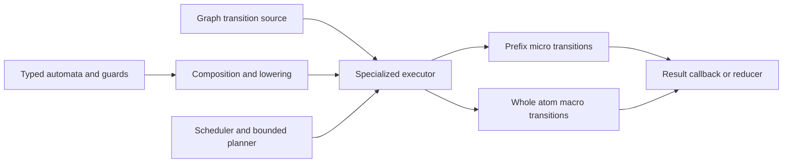

# Scheduled, compositional graph automata

The prototype implements the [perf recommendations](PERF_SHAPES.md) in one
execution engine. Whole-atom and prefix schedules share the same compiled guards,
binding effects, source interface, and acceptance semantics. Bounded private
probes choose an order/schedule; masks are compiled and evaluated lazily.

The result preserves AutomatonJoin's uniform-data wins, automatically repairs the
skew order, and approaches FstJoin on the cyclic regressions. It also establishes
a general automaton layer without adding trait-object dispatch to the hot loop.
Production executors and storage remain unchanged; all additions are injected
into the disposable prototype crate by `prototype/prepare.py`.

## Architecture: common semantics, specialized execution

[`automata_core.rs`](prototype/automata_core.rs) provides:

| Component | Responsibility |
|---|---|
| `Automaton<Event, Context>` | Initial state, transition, explicit acceptance, conservative liveness |
| `And`, `Or` | Intersection/union over a common typed alphabet |
| `Not` | Language complement with an explicit sink for missing transitions |
| `MapInput` | Typed one-event-to-one-event alphabet mapping |
| `Transducer`, `Project`, `Reducer` | Typed outputs and persistent aggregation effects |
| `ReversibleAction`, `Actions` | Register/context effects with reverse-order undo |
| `BitmapAutomaton` | Optional packed-transition specialization |
| `Unfiltered` | Correct adapter when an automaton has no prefix-mask oracle |
| `BitmapSource`, `GraphAutomaton` | Storage transitions and the corresponding graph language |
| `TripleSource` | Triple-coordinate layout/domain adapter, outside the general algebra |
| `visit_language` | Generic finite-source product runner with final-step acceptance |

Automata describe accepted runs. Sources provide graph transitions. Schedulers
choose which product state to expand. Effects update bindings or other execution
context. Callbacks consume results. These responsibilities can be reused without
requiring all algorithms to share one traversal loop.



For joins, each relation has its own physical cursor. Equal variables can occupy
different physical dimensions; **their logical bits** are constrained together.
Intersection does not mean equating raw slot numbers from different atoms.
The compiler maps slot bits into the common variable registers.

The generic alphabet is unrestricted: byte automata and mapped input are tested
with the same algebra as storage automata. Future edge/vertex automata can use
typed edge events; dictionary matching can use bytes. Their adapters/schedulers
remain distinct. [The analytics extension](ANALYTICS_AND_LARGE_BGP.md) now tests
typed edge contributions, reductions, and synchronous iteration with PageRank
and label propagation over compressed and CSR edge sources.
The [binding/path extension](QUERY_OPERATORS_AND_PATHS.md) now bridges the
existing NFA runner to the FST and shared language algebra, with binding-aware
OPTIONAL, MINUS, existence, and multiset union. Production APIs remain unchanged.
State keys must preserve
relevant automaton/register context: an FST address alone is insufficient for
join memoization, and sharing a physical suffix must preserve output-path
multiplicity.

Recognition reads context; effects mutate it separately. This avoids composing
recognizers that accidentally modify one another's bindings. Effects are undone
in reverse order. Acceptance is checked after the final transition, including
in the generic runner. Complement deliberately has no inverted-prefix-mask
implementation: `Unfiltered(Not(machine))` preserves correct acceptance while
letting the graph source limit the explored transitions.

`BitmapSource` is an immutable, infallible fast path. A future I/O executor must
carry I/O errors independently of language rejection. A source that mutates
must invalidate/recompile query plans, including any empty-answer certificate.

## The compiled join machine

[`scheduled_join.rs`](prototype/scheduled_join.rs) supports:

- `Nested`: complete each atom before entering the next.
- `Prefix(k)`: synchronize the first `k` physical levels, then complete atoms.
- `Levels`: synchronize all levels, matching FstJoin's search.
- `Adaptive`: bounded planning chooses an order and one of those schedules.

The compiler emits control stages in the selected event order. Each stage
contains an intersection of a constant/local-equality mask and a binding guard,
plus bit-write effects. Every variable bit has one statically assigned writer;
later occurrences check its value. High bits excluded by an occurrence's domain
are known zero before assigning writers. This handles unequal dimension widths,
non-power-of-two domains, shared predicates, and repeated variables.

Changing the schedule **recompiles ownership**. It never reuses FstJoin's fixed
writer ordering under a different execution order.

### Macro transitions and masks

For an atom with distinct variables across dimensions, its remaining descent
can become one macro transition:

1. Capture the bindings known at atom entry.
2. Compute a level's guard mask when that level is first reached; reuse it across
   the atom's sibling descents. An invocation stamp prevents stale masks.
3. Decode only owned variable bits into three small local coordinate values.
4. Publish complete values at a leaf, then enter the next atom.
5. Overwrite those values at the next leaf; clear owned bits once when returning
   from the atom, rather than after every output.

Guard masks are cached in exact-sized reusable workspace, one entry per compiled
stage. There is no 64-element mask array to initialize on every atom invocation,
and no `DimRestriction` dispatch inside the walk. A failed root probe builds
only its root mask. The original source bitmap is retained for child rank.

The macro optimization depends on internal data dependencies. A repeated
variable within an atom can require cross-level checks against bits written
inside that same atom. Such queries use the general compiled micro-transition
executor. They remain correct, with the same ownership rules, rather than
silently applying an invalid macro optimization. Queries above 64 distinct atoms
also use flat micro-transition execution to bound call-stack depth. Large-query
deduplication and ordering now use an incidence index and priority heap; see the
[large BGP tests](ANALYTICS_AND_LARGE_BGP.md#large-bgps).

Both executors specialize the same automaton contract. Rust generics inline the
small component operations. The join kernel uses stateless fused guard products
and compiled effects, while the general runner supports stateful components.
Warmed join visits reuse their vectors and allocate nothing in the traversal.

## Planning pseudocode

```text
prepare(query, immutable_source, policy):
    validate terms, domains, variables; deduplicate atoms
    compile static masks and variable-bit ownership for the chosen schedule

    if policy is explicit:
        return compiled plan

    if an atom has a fixed subject and at least two constants:
        put that direct lookup first; choose Nested; return

    result = privately probe Levels, at most 64 node reads
    if result exhausts the complete search:
        if no complete binding exists: retain an empty-answer certificate
        return this plan

    best = none
    for at most six candidate atom orders:
        result = privately probe Nested, at most 128 node reads
        if complete search exhausts with no binding:
            return an empty-answer certificate

        score primarily by complete bindings per node read
        otherwise use completed final-atom probe attempts per node read
        retain the best observed order

        if this best order has no outputs and
           final-atom attempts > 4 * completed first-atom rows:
            choose Prefix(min(2, height)); stop order search

    otherwise choose Nested with the best observed order
    recompile ownership and guards for the final schedule
    discard probe bindings; public visits execute independently
```

The anchored shortcut is a physical S/P/O-layout heuristic, not part of the
abstract automaton algebra. The general case reads at most **832 graph nodes**:
64 plus six probes of 128. Word reads bound planning exploration; candidate and
callback work can additionally fan out within a 64-slot word. Compilation still
scales with query size. Samples are deterministic and can be biased; the policy
is a measured prototype heuristic, not a universal cost estimator.

No private probe emits to the caller. An unfinished probe never certifies
emptiness. A finished empty probe does genuine query evaluation during
preparation; its work/time is included below. The query plan borrows an immutable
graph. It stores no materialized relation or general answer table.

## Traversal pseudocode

```text
visit(plan):
    reset reusable bindings and mask stamps
    traverse the compiled prefix stages with backtracking:
        open this atom's physical cursor
        allowed = source bitmap AND compiled guard(current bindings)
        for each allowed slot:
            apply this stage's owned-bit effects
            advance this atom's cursor
            continue the prefix, or invoke the suffix macro sequence
            undo this stage's owned-bit effects

    macro(atom, cursor, entry_bindings):
        decode owned bits locally while descending
        obtain each reached level's mask once for this invocation
        at each leaf:
            publish the atom's complete owned values
            invoke the next atom, or emit the complete binding
        restore this atom's owned bits on return
```

Sibling traversal retains each parent's original address/bitmap. Cancellation
is propagated through both kernels; subsequent visits reset execution state.
Independent workspaces can traverse one borrowed plan independently.

## Measured comparison

Rust 1.98.1, profiling profile, default target CPU, single-threaded Ryzen 5 PRO
4650U. Same synthetic fixtures as the preceding investigations, plus the mixed
cycle below. Warmup and five repetitions with adaptive batches; sequential
engines; graph construction excluded. **Total time includes fresh plan, bounded
probes, workspace, traversal, and destruction.** Independent medians are not
summed to obtain total time.

| Case | Existing AutomatonJoin total | FstJoin total | Adaptive total |
|---|---:|---:|---:|
| uniform-star | 19.93 ms | 35.47 ms | 19.98 ms |
| uniform-triangle | 15.58 ms | 30.91 ms | 15.00 ms |
| uniform-anchored | 2.45 µs | 94.02 µs | 3.31 µs |
| skew | 111.79 ms | 12.10 ms | 4.03 ms |
| parity-triangle-32 | 4.39 ms | 1.11 µs | 1.30 µs |
| parity-triangle-64 | 34.44 ms | 1.11 µs | 1.32 µs |
| parity-triangle-128 | 254.08 ms | 1.16 µs | 1.35 µs |
| mixed-triangle | 34.34 ms | 41.12 µs | 44.31 µs |
| dense-star | 77.60 µs | 83.15 µs | 78.67 µs |

Star produces 4,950 bindings; skew 1,053; dense-star 16,384; mixed-triangle 64.
The other fixtures are empty. The star and dense-star differences versus
AutomatonJoin are small enough to treat as parity. Uniform triangle improves
modestly. Skew improves about 28× through automatic ordering plus the compiled
nested kernel. The cyclic empty fixture stays within ~0.2 µs of FstJoin.

The main remaining regression is the anchored lookup: similar/faster traversal,
but larger plan construction adds about **0.85 µs total** versus AutomatonJoin.
The mixed cycle is ~8% slower than FstJoin in total. These costs stay visible;
they would matter in an extremely low-latency workload.

### Planning work and selected schedules

| Case | Planning node reads | Trials | Selected cut | Selected atom order |
|---|---:|---:|---:|---|
| uniform-star | 320 | 3 | 0 | `[0, 1]` |
| uniform-triangle | 832 | 7 | 0 | `[0, 1, 2]` |
| uniform-anchored | 0 | 0 | 0 | `[0, 1]` |
| skew | 320 | 3 | 0 | `[1, 0]` |
| parity-triangle-128 | 25 | 1 | 3 | `[0, 1, 2]` |
| mixed-triangle | 192 | 2 | 2 | `[0, 1, 2]` |
| dense-star | 0 | 0 | 0 | `[0, 1]` |

Cut zero is nested; cut equal to height is fully synchronized. The contradictory
cycle is **proved empty during preparation** after 25 reads, so its near-zero
prepared visit is only an empty-plan check. Its ~1.35 µs total includes that
proof. The mixed cycle remains nonempty and exercises actual two-level prefix
synchronization followed by whole-atom macros.

### Nonempty mixed-cycle control

The fixture has two groups of 64 IDs. R and S connect pairs within each group.
T contains opposite-group pairs and one within-group edge. The query
`R(x,y), S(y,z), T(z,x)` has exactly 64 independently known answers. Nested
execution encounters a large unsuccessful intermediate region before them.

| Schedule | Prepared visit | Node reads |
|---|---:|---:|
| scheduled-nested | 10.62 ms | 747,017 |
| scheduled-prefix1 | 1.27 ms | 85,147 |
| scheduled-prefix2 | 38.39 µs | 2,475 |
| scheduled-levels | 35.27 µs | 2,475 |
| scheduled-adaptive | 38.50 µs | 2,475 |

Always synchronizing one or two levels is not a universal improvement. On skew,
forced cuts 1/2 take about 121/243 ms; on the uniform star, cut 2 adds work.
The planner therefore preserves nested execution unless it observes a reason
to synchronize. The mixed-cycle result shows why the option is useful.

### Space and perf

Uniform-star adaptive plan capacity is 3,888 B and workspace 688 B, versus
AutomatonJoin's 112 B/16 B and FstJoin's 3,024 B/1,136 B. Metadata is larger than
the old nested executor, but independent of graph cardinality. Counts exclude
inline objects, allocator overhead, borrowed graph storage, and transient
planning memory; they are not process peak memory.

Paired same-binary perf on the contradictory triangle deliberately forces the
nested schedule to isolate kernel improvements. It preserves the **4,817,417
node reads**, yet reduces instructions from **3.794 billion to 1.146 billion**
and sampled-run time from **293 ms to 73 ms**. The new self profile is roughly
68% descent, 20% word reads, 10% atom entry, and 2% delta reads. Mask-array zeroing
and generic restriction compilation disappear from the visible hot spots.
This kernel improvement still cannot replace early prefix pruning.

Adaptive prepared-star profiling executes about **239 million instructions**.
The previously profiled AutomatonJoin used ~250 million on the same fixture;
there is no evidence here of a large generic-composition penalty. Adaptive skew
executes ~48 million instructions with 216,250 node reads. These are separate
profile runs; the directly measured total-time table is the primary comparison.
FIFO control excludes graph construction, validation, warmup, and planning from
prepared-visit perf. Six counters are multiplexed at ~83% active time and scaled
by perf. Recording uses user cycles at 999 Hz with DWARF stacks. Calibrated run
lengths vary; exact durations and repetitions are retained in the raw records.

## Validation

**88 tests pass**: 70 existing, 11 earlier prototype tests, and seven new tests.
Every policy runs through explicit and randomized brute-force binding oracles,
reversed atom orders, and cancellation/reuse checks. Levels mode is additionally
checked for identical node/candidate counts to FstJoin. New coverage includes
full-width IDs, unequal/non-power-of-two domains `[33,5,129]`, repeated variables,
shared predicates, an independent one-word storage backend, and 72 atoms/vars.
Automaton tests cover union branch death, complement's sink, typed input mapping,
reversible-effect order, generic graph/source composition, final acceptance,
and cancellation. Probe budgets and empty-certificate validity are checked.

All nine benchmark cases compare complete sorted bindings against FstJoin.
Skew, dense-star, and both cycle fixtures additionally have source-derived
expected bindings. The current FST's height-zero storage limitation remains
unchanged; see [the earlier report](ON_DEMAND_JOIN.md).

## Reproduction and artifacts

```sh
join_snapshot=$(python3 examples/join/prototype/prepare.py)
CARGO_TARGET_DIR=/tmp/sgraph-composition-target cargo test --offline --profile profiling --manifest-path "$join_snapshot/Cargo.toml" --lib --tests
CARGO_TARGET_DIR=/tmp/sgraph-composition-target cargo build --offline --profile profiling --manifest-path "$join_snapshot/Cargo.toml" --example composition_bench --example join_profile
PROTO_SUITE=joins PROTO_REPS=5 PROTO_ENGINE=fst,demand,automaton,scheduled-nested,scheduled-prefix1,scheduled-prefix2,scheduled-levels,scheduled-adaptive /tmp/sgraph-composition-target/profiling/examples/composition_bench
```

`PROTO_CASE` filters by substring. Explicit schedules are useful controls when
investigating a policy choice. Profile one engine/case without graph-build noise:

```sh
cp /tmp/sgraph-composition-target/profiling/examples/join_profile /tmp/sgraph-scheduled-profile
python3 examples/join/prototype/shape_perf.py /tmp/sgraph-scheduled-profile --output /tmp/scheduled-perf --cases uniform-star,skew,mixed-triangle --engines scheduled-adaptive --target-seconds 1.5
```

Evidence: [72 comparison rows](prototype/results/scheduled-comparison.csv),
[planning/traversal counts](prototype/results/scheduled-work.json),
[diagnostic log](prototype/results/scheduled-comparison.log),
[test log](prototype/results/scheduled-tests.log),
[source/binary manifest](prototype/results/scheduled-manifest.txt),
[adaptive perf medians](prototype/results/scheduled-perf/perf-summary.json),
[paired nested-kernel control](prototype/results/scheduled-perf/mask-control/perf-summary.json).
The preceding experimental passes remain in `scheduled-initial`,
`scheduled-second`, and `scheduled-mixed` files. In `scheduled-initial.csv` only,
the shared `source_reuses` column contains planning node reads; subsequent CSVs
leave it zero and report planning work separately. `retained_states` counts
compiled control stages, not an expanded/minimized product automaton.

The next architectural step is adding adapters and schedulers for another real
graph operation using this algebra, while keeping its optimized executor. The
current result supports sharing automaton semantics and components with
specialized lowering. It does not establish one universally fastest schedule.
